# Active Directory Lab

Windows Server 2025 domain controller on Proxmox VE with a domain-joined Windows 11 client: OU design, AGDLP security groups, file shares, a PowerShell CSV bulk import and Group Policy, all built, tested and documented end to end.

Part of my IT administration homelab series (project 3), running on the Proxmox host from [proxmox-homelab](https://github.com/rkraus-tech/proxmox-homelab).

---

## Overview

**Goal:** Build a realistic small-company Active Directory environment from scratch and prove that every piece works from the client's point of view.

**What was built:**

- **DC01**: Windows Server 2025 VM on Proxmox, promoted to the first domain controller of a new forest `lab.home.arpa` (AD DS + integrated DNS)
- **OU structure** with a company root OU, users by department, groups and computers
- **Security groups following AGDLP** with NTFS-permissioned SMB shares
- **Bulk user import** from CSV with an idempotent PowerShell script supporting `-WhatIf`
- **Group Policy**: domain password/lockout policy and an OU-targeted desktop wallpaper GPO
- **CL01**: Windows 11 Enterprise VM joined to the domain to test logon, share access and GPO application

**Result:** Domain users sign in on CL01, get exactly the share access their department grants, and receive (or don't receive) the department GPO, verified with `whoami`, `net accounts /domain` and `gpresult`.

---

## Architecture / Setup

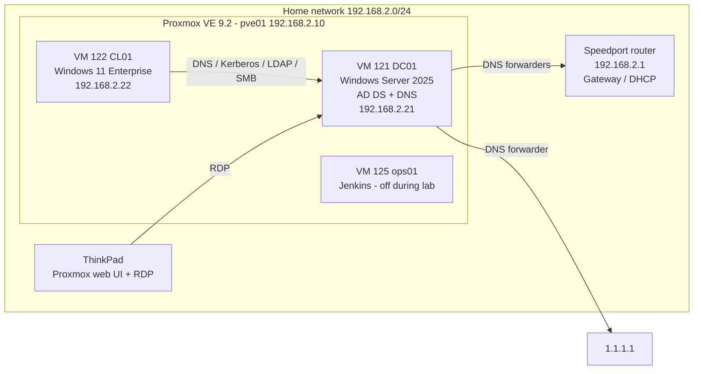

### Virtual machines

| VM ID | Hostname | OS | vCPU | RAM | Disk | IP | Notes |
|---|---|---|---|---|---|---|---|
| 121 | DC01 | Windows Server 2025 Standard Eval (Desktop Experience) | 2 (host) | 4 GB fixed | 60 GB | 192.168.2.21 | UEFI + Secure Boot, start at boot (order 1) |
| 122 | CL01 | Windows 11 Enterprise Eval | 2 (host) | 4 GB (balloon to 2 GB) | 64 GB | 192.168.2.22 | UEFI + Secure Boot + vTPM 2.0 |

Convention from the previous project: **VM ID = last octet of the IP**. All disks are thin-provisioned on `local-lvm` with Discard/TRIM, IO thread and SSD emulation; VirtIO SCSI and VirtIO network with the QEMU guest agent.

### Domain

| Setting | Value |
|---|---|
| Forest / domain | `lab.home.arpa` (RFC 8375 home-network namespace) |
| NetBIOS name | `LAB` |
| Functional level | Windows Server 2025 (domain and forest) |
| DNS forwarders | 192.168.2.1, 1.1.1.1 |

### OU structure

```
lab.home.arpa
└── _LAB
    ├── Users
    │   ├── IT          (tom.mueller, anna.schmidt, lukas.wagner, jonas.weber)
    │   └── Sales       (sarah.becker, julia.hoffmann, felix.schneider, laura.fischer)  <- GPO U_Sales_Desktop_Wallpaper
    ├── Groups          (GG_* and DL_* security groups)
    └── Computers
        └── Clients     (CL01 - default target for new computers via redircmp)
```

### AGDLP

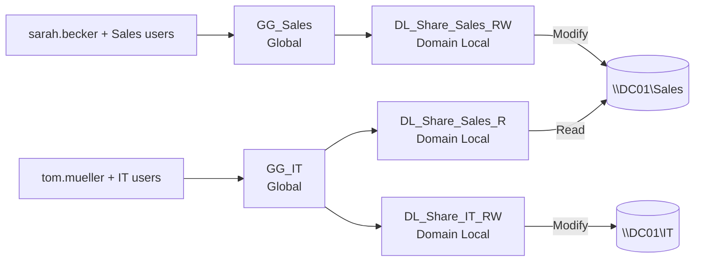

Permissions are set **only on domain local groups**, never on users. NTFS is the single source of truth (share permissions: Authenticated Users = Change), Access-Based Enumeration is enabled.

---

## Tech Stack

| Area | Technology |
|---|---|
| Virtualization | Proxmox VE 9.2 (KVM/QEMU), OVMF/UEFI, Secure Boot, vTPM 2.0, VirtIO drivers, QEMU guest agent |
| Server | Windows Server 2025 Standard (Evaluation), `sconfig` |
| Directory | Active Directory Domain Services, integrated DNS |
| Client | Windows 11 Enterprise (Evaluation) |
| Automation | Windows PowerShell 5.1 (`ActiveDirectory`, `GroupPolicy`, `SmbShare`, `NetTCPIP`, `DnsClient`, `DnsServer` modules) |
| Management tools | ADUC (`dsa.msc`), GPMC (`gpmc.msc`), `gpresult`, `icacls`, `redircmp` |
| Documentation | Git / GitHub, Markdown, Mermaid |

---

## Steps Taken

### Phase 1 - Repository & preparation
- Created this repository with `.gitignore` (unredacted screenshots in `screenshots/raw/`, secrets and ISOs never committed) and `.gitattributes` (CRLF for PowerShell/CSV, LF for Markdown).
- Downloaded the Windows Server 2025 and Windows 11 Enterprise evaluation ISOs (en-US) plus `virtio-win.iso` directly to Proxmox via *Download from URL*.
- Checked host resources and shut down the Jenkins VM `ops01` to free RAM for two Windows VMs.

### Phase 2 - Design decisions
- Lab on the home network with static IPs (internet for activation/updates, RDP from the laptop); segmentation planned for a later OPNsense/VLAN project. DC01 runs no DHCP to avoid a conflict with the router.
- Domain `lab.home.arpa` (reserved, never collides with a public domain; `.local` avoided because of mDNS).
- IP plan, hostnames and VM sizing (see tables above).

### Phase 3 - DC01 VM & Windows Server installation
- VM with UEFI + Secure Boot, VirtIO SCSI, fixed RAM (no ballooning on a DC), CPU type `host`.
- Loaded the `vioscsi` driver during setup, installed Desktop Experience, then `virtio-win-guest-tools.exe`.

### Phase 4 - Promotion to domain controller
- `sconfig`: static IP, hostname `DC01` (before promotion), Remote Desktop with NLA.
- `Install-WindowsFeature AD-Domain-Services -IncludeManagementTools` and `Install-ADDSForest` with integrated DNS.
- Hardened DNS: forwarders 192.168.2.1 + 1.1.1.1, DNS client = own IP first, loopback second.
- Verified evaluation activation (`slmgr /xpr`) and set DC01 to start first on host boot.
- Script: [`scripts/01-Promote-DC.ps1`](scripts/01-Promote-DC.ps1)

### Phase 5 - OU structure, AGDLP groups, shares
- Hybrid OU design under `_LAB` (default `Users`/`Computers` are containers: no GPO links possible).
- Global groups `GG_IT`, `GG_Sales`; domain local groups `DL_Share_*`; nesting G -> DL.
- Shares `\\DC01\Sales` and `\\DC01\IT` with inheritance removed and NTFS rights only for DL groups.
- Two test users created manually to learn the required attributes.
- Script: [`scripts/02-Create-Structure.ps1`](scripts/02-Create-Structure.ps1)

### Phase 6 - Bulk user import from CSV
- [`configs/users.csv`](configs/users.csv) holds only business data (FirstName, LastName, Department, Title), no passwords.
- [`scripts/03-Import-Users.ps1`](scripts/03-Import-Users.ps1) derives logon name, UPN, OU and role group; supports `-WhatIf`; is idempotent; validates departments; handles errors per row; prints a summary.
- Workflow: dry run (6 x WhatIf) -> import (6 x Created) -> second run (6 x Skipped).

### Phase 7 - Windows 11 client & domain join
- VM with vTPM 2.0, Secure Boot, ballooning; local emergency admin instead of a Microsoft account.
- Static IP, DNS pointing to DC01 for IPv4 **and** IPv6, rename to `CL01`.
- `redircmp` on DC01 so new computers land in `_LAB\Computers\Clients`; joined via `sysdm.cpl`.
- First domain logon with forced password change; AGDLP verified from the client (write on Sales, access denied on IT).
- Script: [`scripts/04-Join-Client.ps1`](scripts/04-Join-Client.ps1)

### Phase 8 - Group Policy
- Domain password policy (`Set-ADDefaultDomainPasswordPolicy`): min length 14, complexity, history 24, no forced expiry, min age 1 day, lockout 5 attempts / 15 min. Verified with `net accounts /domain` on the client.
- GPO `U_Sales_Desktop_Wallpaper` (user settings only), image in NETLOGON, linked only to the Sales OU.
- Positive test (Sales user gets it) and negative test (IT user does not), verified with `gpresult /r /scope user`.
- Script: [`scripts/05-Create-GPOs.ps1`](scripts/05-Create-GPOs.ps1)

Detailed working notes: [`docs/notes.md`](docs/notes.md)

---

## Challenges & Solutions

| # | Challenge | Root cause | Solution |
|---|---|---|---|
| 1 | ISO download on Proxmox failed: `unable to resolve host address` | `/etc/resolv.conf` on pve01 only listed the router, whose DNS answered inconsistently (single point of failure) | Added 1.1.1.1 and 9.9.9.9 as fallback DNS on pve01, verified with `getent ahostsv4`, retried with the direct CDN URL from the task log |
| 2 | Windows Setup showed no disk | Windows has no driver for the VirtIO SCSI controller | *Load Driver* -> `virtio-win` -> `vioscsi\<version>\amd64` |
| 3 | DNS forwarders after promotion were 192.168.2.1 and `fe80::1` | Promotion inherited the previous DNS servers incl. a link-local IPv6 address | Set forwarders to 192.168.2.1 + 1.1.1.1; DNS client: own IP first, loopback second |
| 4 | Client: `Resolve-DnsName lab.home.arpa` -> "DNS name does not exist" | The router advertises itself as IPv6 DNS (RA/RDNSS); the client asked the router instead of the DC | Pointed IPv6 DNS to DC01 as well (IPv6 left enabled). In production: advertise the DCs via RA/DHCPv6 |
| 5 | Pasted user-creation block used a wrong password | `Read-Host` consumes the next pasted line as input | Run the `Read-Host` line separately, then paste the rest |
| 6 | `Add-Computer -Credential` hung | Credential dialog did not appear in the noVNC console; Ctrl+C was swallowed by the browser | Closed the window, joined via `sysdm.cpl` |
| 7 | Domain user could not sign in: "The sign-in method you're trying to use isn't allowed" | Attempt was made on the DC01 console; normal users have no *Allow log on locally* right on domain controllers | Expected security behavior; signed in on CL01 |
| 8 | GPMC *Settings* report blocked | IE Enhanced Security Configuration blocks the console's internal report page | Added `about:security_mmc.exe` to the trusted zone |
| 9 | GPO report showed empty *Wallpaper Style* and *Extra Registry Settings* | Used value `10` (user-setting scale) instead of the policy scale 0-5 | Set `WallpaperStyle` to `4` (Fill) |

---

## Key Learnings

- **DNS is the foundation of Active Directory.** Clients find the domain only through DNS SRV records; a single wrong DNS server (here: IPv6 from a consumer router) breaks the domain join.
- **Order matters on a DC:** static IP and final hostname before promotion; role installation and promotion are separate steps.
- **AGDLP keeps permissions maintainable:** rights are set once on domain local groups; onboarding means adding a user to one global group.
- **Containers vs. OUs:** GPOs cannot be linked to the default `Users`/`Computers` containers; `redircmp` fixes the default location for new computers.
- **Password policy for domain accounts lives at domain level**; per-group rules need Fine-Grained Password Policies. Modern guidance favors length and lockout over forced periodic changes.
- **Test both directions:** a GPO or permission is only proven when the positive and the negative case behave as expected (`gpresult`, `whoami`, access denied).
- **Automation needs safety nets:** `-WhatIf`, idempotency, validation and per-record error handling turn a quick loop into a script that can run in production.
- **Read logs before retrying:** every challenge above was solved by reading the actual error, not by guessing.

### Lab simplifications (would differ in production)

- Single DC: production needs at least two DCs for redundancy.
- File shares on the DC: production uses a dedicated file server.
- Flat home network: production separates server, client and management networks (planned: OPNsense/VLAN project).
- Built-in Administrator used for administration: production uses separate, named admin accounts (tiering).

### Next steps

- **Help-Desk-Lab:** helpdesk scenarios (password resets, account lockouts, group changes) in this domain.
- Second domain controller, dedicated file server, LAPS for local admin passwords.
- Network segmentation with OPNsense and VLANs.

---

## Screenshots

| # | Screenshot | Shows |
|---|---|---|
| 01 | 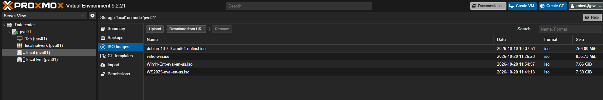 | Installation media on Proxmox storage `local` |
| 02 | 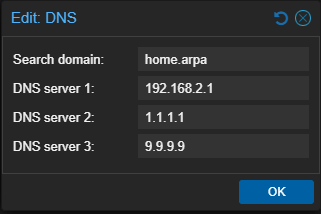 | Fallback DNS servers on pve01 (challenge 1) |
| 03 | 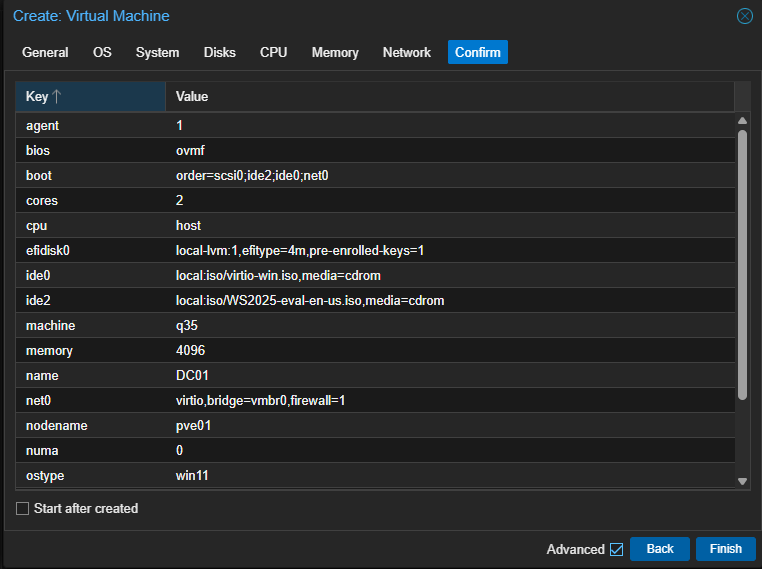 | DC01 VM configuration |
| 04 | 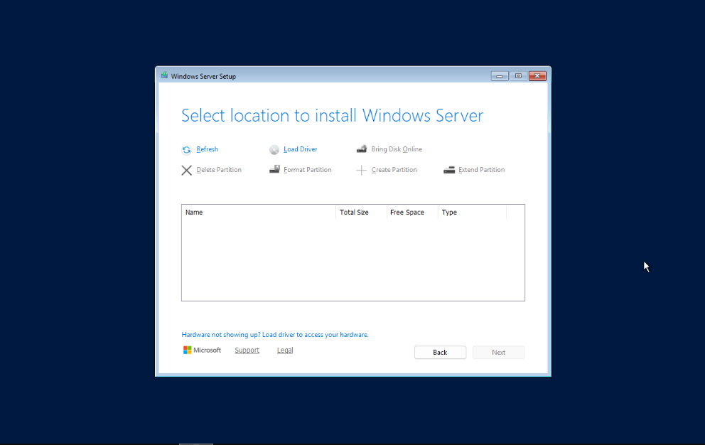 | Windows Setup without VirtIO driver (challenge 2) |
| 05 | 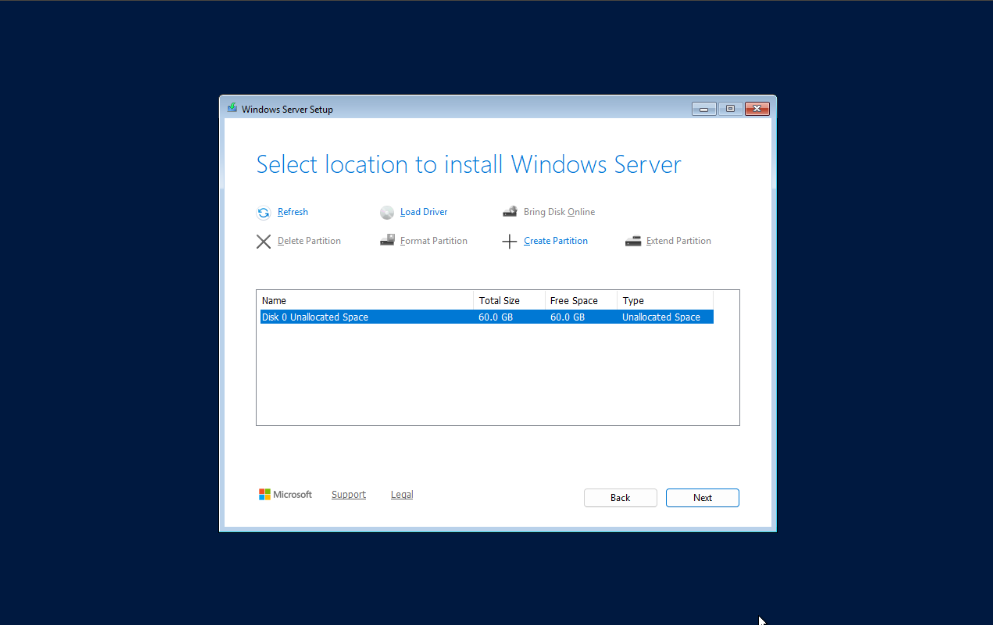 | Disk visible after loading `vioscsi` |
| 06 | 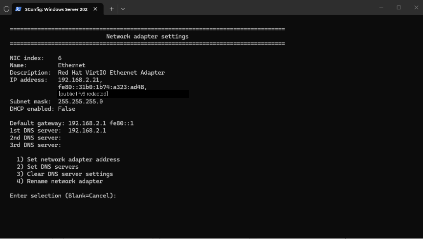 | Static IP via `sconfig` |
| 07 | 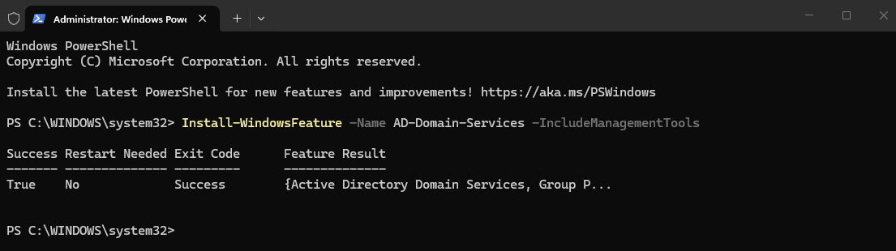 | AD DS role installed via PowerShell |
| 08 | 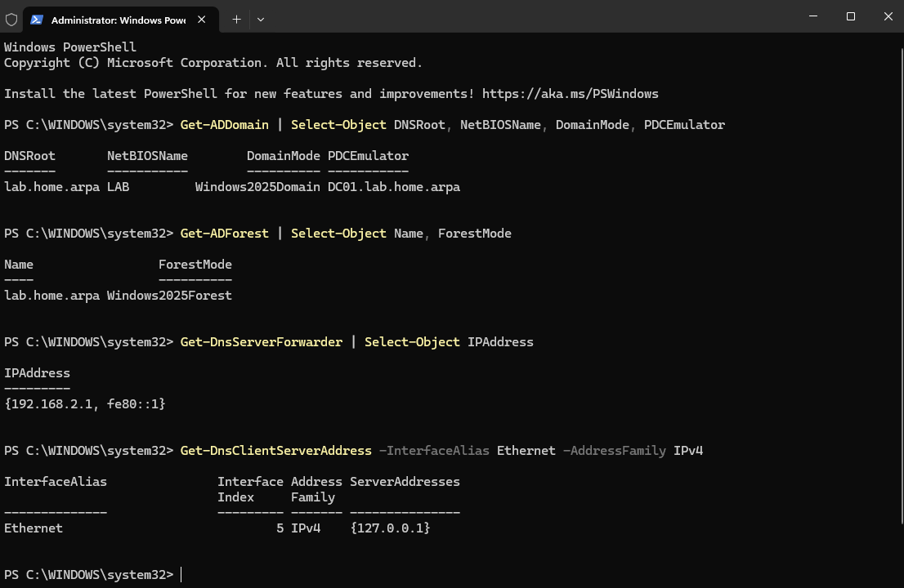 | Domain, forest, forwarders and DNS client after promotion |
| 09 | 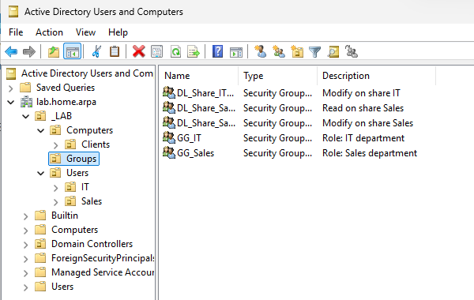 | OU structure and AGDLP groups in ADUC |
| 10 | 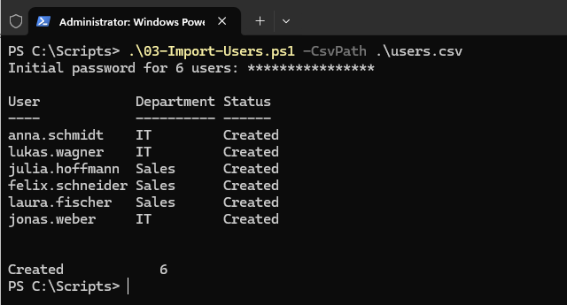 | CSV import: 6 users created |
| 11 | 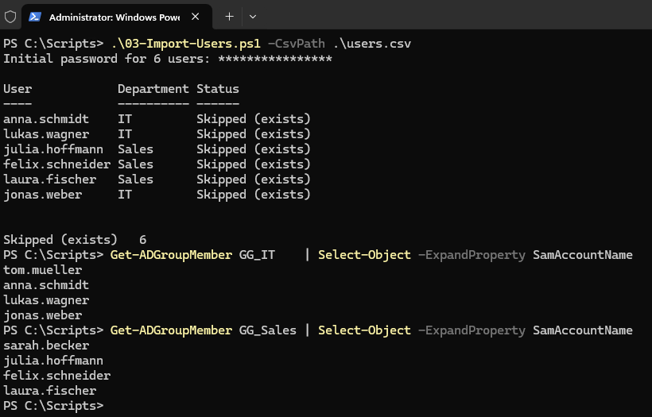 | Second run skips existing users; group membership |
| 12 | 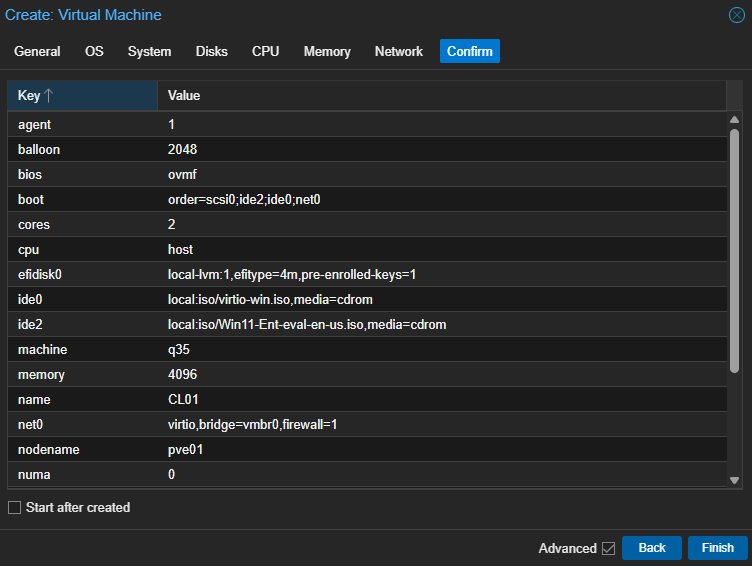 | CL01 VM configuration (ballooning, TPM) |
| 13 | 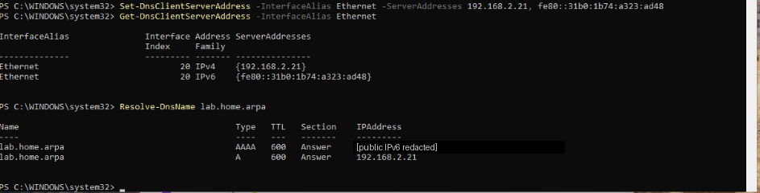 | Client DNS for IPv4 and IPv6 pointing to DC01 (challenge 4) |
| 14 | 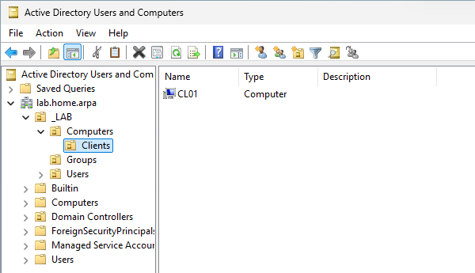 | CL01 automatically placed in `Clients` OU |
| 15 | 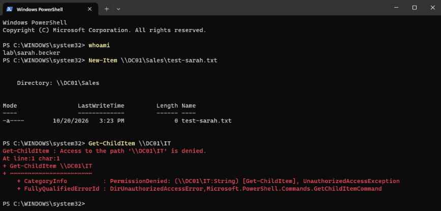 | Sales user: write on Sales, access denied on IT |
| 16 | 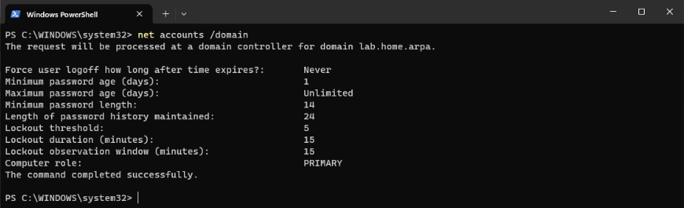 | Domain password policy seen from the client |
| 17 | 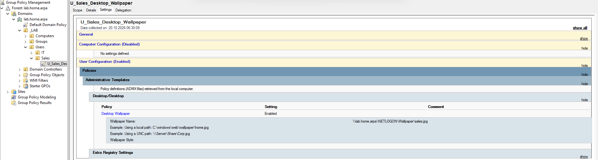 | Wallpaper GPO linked to the Sales OU |
| 18 | 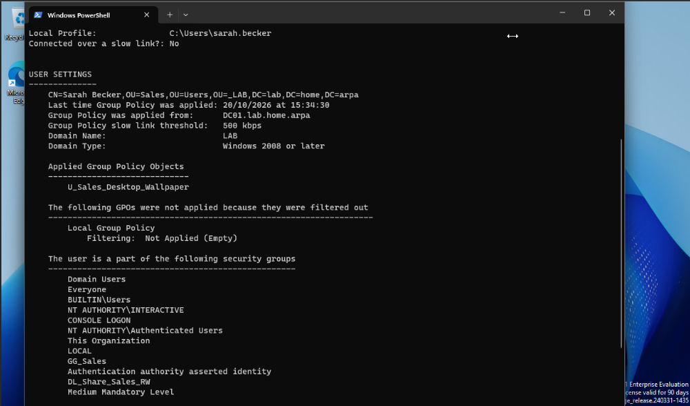 | Sales user: GPO applied, new wallpaper |
| 19 | 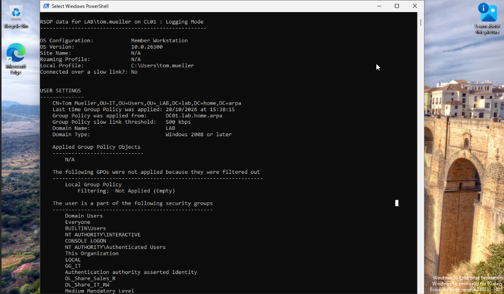 | IT user: GPO not applied (negative test) |

Public IPv6 addresses are redacted in the screenshots.

---

## Repository structure

```
ad-lab/
├── README.md
├── configs/
│   └── users.csv                 # CSV input for the bulk import
├── docs/
│   └── notes.md                  # detailed working notes per phase
├── screenshots/                  # 01-19, redacted
└── scripts/
    ├── 01-Promote-DC.ps1         # AD DS role, new forest, DNS settings
    ├── 02-Create-Structure.ps1   # OUs, AGDLP groups, shares + NTFS
    ├── 03-Import-Users.ps1       # CSV bulk import (WhatIf, idempotent)
    ├── 04-Join-Client.ps1        # client IP/DNS, rename, domain join
    └── 05-Create-GPOs.ps1        # password policy, Sales wallpaper GPO
```

## License

MIT
